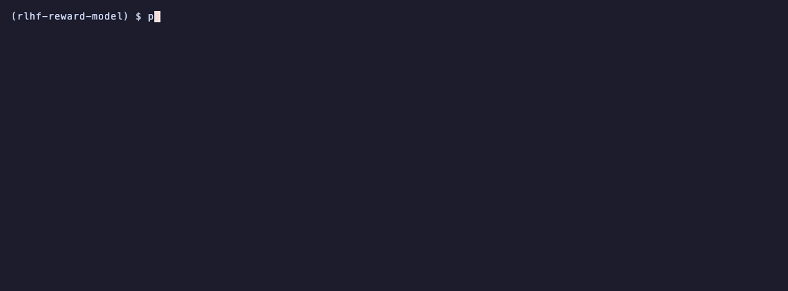
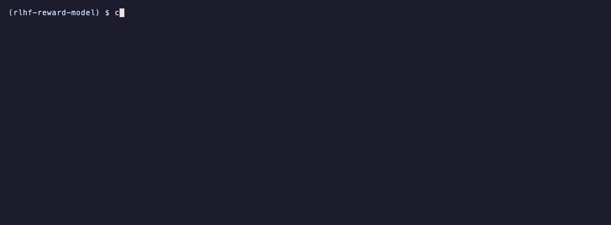
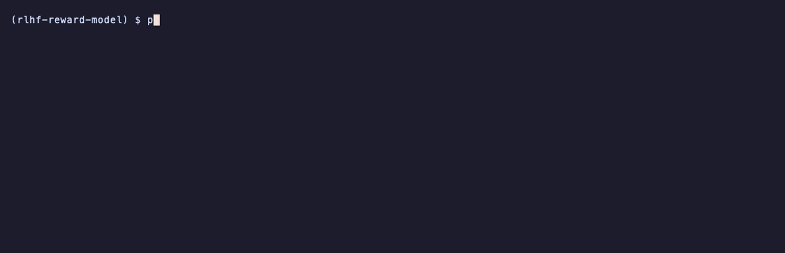

<h1 align="center">RLHF Reward Model</h1>

<p align="center">
  <em>Classical RLHF built from scratch: a Bradley-Terry reward model with PPO, a from-scratch DPO implementation and a head-to-head PPO-vs-DPO comparison, and an explicit reward over-optimization study.</em>
</p>

<p align="center">
  <a href="https://github.com/adeoluo/rlhf-reward-model/actions/workflows/ci.yml"></a>
  <a href="https://github.com/adeoluo/rlhf-reward-model/releases"></a>
  
  <a href="LICENSE"></a>
</p>

---

## Motivation

Reinforcement learning from human feedback is the classical post-training recipe behind
instruction-following assistants. It has three stages: supervised fine-tuning, training a
**reward model** on human preference comparisons, and optimizing the policy against that reward
with a clipped policy gradient while a KL penalty holds it near the reference. This project
implements the whole pipeline **from scratch** on a tractable alignment task: a
reference fit by **behavior cloning**, a **Bradley-Terry reward model** fit by convex logistic
regression, and **PPO** with a clipped surrogate and KL-shaped reward. It also implements the
reward-model-free alternative, **Direct Preference Optimization (DPO)**, and runs a **head-to-head
PPO-vs-DPO comparison** on the same task, all with no automatic
differentiation. Finally it demonstrates the failure mode that makes reward modeling hard:
**reward over-optimization**.

## Architecture

<p align="center">
  
</p>

<sub>Legend: amber = entry points and external systems, indigo = core logic, green = data and state, blue = validation and control, grey = observability and outputs.</sub>

A hidden gold reward defines the truth and generates the demonstrations and the
Bradley-Terry preference pairs. The pipeline runner behavior-clones a reference, fits a reward
model on the preferences, and optimizes a PPO policy against the learned reward with a KL
anchor to the reference; DPO fits a policy straight to the same preferences. The learner never
sees the true reward. The report, the PPO versus DPO comparison, and the over-optimization
study measure the outcome against the gold reward, and the HTTP service serves the trained
models with per-route metrics. See the [ADRs](docs/adr/) for the key decisions.

### The pipeline

- **Supervised fine-tuning.** A reference policy is behavior-cloned from weakly aligned
  demonstrations by penalized maximum likelihood.
- **Reward model.** A linear reward is fit by **Bradley-Terry** logistic regression on
  preference pairs: the probability that the chosen response beats the rejected one is the
  logistic of their reward difference. The objective is concave, so full-batch gradient ascent
  recovers the regularized optimum.
- **PPO.** The policy is optimized against the learned reward with the clipped surrogate
  objective. The KL penalty is folded into the reward,
  `shaped = reward_model(y) - beta * (log policy_old(y) - log reference(y))`, and each iteration
  samples from the current policy, estimates a per-prompt baseline, and takes clipped gradient
  steps. The policy-gradient term for the log-linear policy is exact.
- **DPO.** Direct Preference Optimization skips the reward model and fits the policy straight to
  the preferences with a single logistic loss on the implicit reward margin
  `beta * log(policy / reference)`. For the log-linear policy the gradient is exact and
  hand-derived, so PPO and DPO share the same optimizer and differ only in method.

### Components

- **domain**: the alignment task, the hidden gold reward, the demonstration teacher, and the
  Bradley-Terry preference annotator.
- **policy**: a log-linear softmax policy with exact distributions and gradients.
- **sft**: behavior cloning of the reference.
- **reward_model**: the Bradley-Terry reward model, with an optional misspecified variant.
- **ppo**: the clipped PPO surrogate with a KL-shaped reward and a per-prompt baseline.
- **evaluation**: reward-model fidelity, true reward, KL, and the reward-model ceiling.
- **pipeline**: the end-to-end three-stage run.
- **dpo**: Direct Preference Optimization with an exact, hand-derived gradient.
- **comparison**: the PPO versus DPO head-to-head on final quality and sample efficiency.
- **overoptimization**: the reward over-optimization study with a misspecified reward model.

## Results

> Reproduce with `python -m rlhf_reward_model evaluate`. All metrics are computed against the
> hidden gold reward, which the learner never observes.

| Metric | Value |
|---|---:|
| **reward model true-reward correlation (Pearson)** | **0.998** |
| reward model held-out ranking accuracy | 0.984 |
| **policy reward gap closed (reference to optimal)** | **96.6%** |
| policy true reward (reference to PPO) | 0.589 to 1.125 (optimal 1.144) |
| mean KL to reference | 1.673 |

The reward model recovers the hidden reward almost exactly (**r = 0.998**), and PPO optimizing
that reward **closes 96.6 percent of the true reward gap** from the supervised reference to the
optimum, while the KL penalty keeps the policy anchored.

### PPO vs DPO

> Reproduce with `python -m rlhf_reward_model methods` (or `uv run python benchmarks/compare_methods.py`).
> PPO and DPO are given the **same** reference, the **same** preferences, and the **same**
> full-batch optimizer, so the comparison isolates the method.

| Method | true reward | gap closed (reference to optimal) | mean KL to reference |
|---|---:|---:|---:|
| **PPO** (reward model + clipped policy gradient) | **1.1247** | **96.6%** | 1.67 |
| **DPO** (direct, no reward model) | 1.0839 | 89.2% | **1.08** |

Sample efficiency, the true reward reached as the number of preference pairs grows:

| preference pairs | PPO | DPO |
|---:|---:|---:|
| 250 | 1.0144 | 1.0074 |
| 500 | 1.0438 | 1.0308 |
| 1,000 | 1.0862 | 1.0247 |
| 2,000 | 1.0897 | 1.0740 |
| 4,000 | **1.1247** | 1.0839 |

Reading the tables: on this synthetic task, **PPO reaches a higher true reward** (closing 96.6% of
the gap vs. 89.2% for DPO) and stays ahead at every data budget, because its explicit reward
model recovers the hidden reward almost exactly (**r = 0.998**), giving the policy a dense,
well-specified target to optimize. **DPO is simpler** (no reward model, one loss) and reaches a
comparable policy at a **lower KL to the reference** (1.08 vs. 1.67), i.e. a gentler update. The
gap is small and specific to this well-specified linear setting; the point is the measured,
apples-to-apples comparison of the two methods built from the same parts, not a universal claim
that one dominates. Both betas are tuned so neither method is handicapped.

### Reward over-optimization (Goodhart's law)

> Reproduce with `python -m rlhf_reward_model overoptimize` (exposed as the library's
> `overoptimization_study`).

A reward model is a proxy. Optimizing a proxy too hard eventually hurts the true objective. With
a deliberately **misspecified** reward model (given only 4 of the 12 features), decreasing the
KL penalty keeps raising the proxy reward while the **true reward peaks and then falls**:

| beta | proxy reward | true reward | mean KL |
|---:|---:|---:|---:|
| 0.20 | 0.233 | 0.846 | 0.89 |
| 0.10 | 0.340 | **0.940** | 1.59 |
| 0.05 | 0.414 | 0.934 | 2.60 |
| 0.02 | 0.458 | 0.859 | 3.82 |
| 0.01 | 0.458 | 0.858 | 3.83 |

This is the central cautionary result of reward modeling, reproduced from scratch: the proxy
rises monotonically, the truth turns over, and the KL budget is the control knob.

### Scale

`benchmarks/scale.py` fits the Bradley-Terry reward model on progressively larger synthetic
preference datasets (120 full-batch iterations each) and reports wall-clock time, throughput,
peak traced memory (`tracemalloc`), and held-out ranking accuracy. Peak memory grows linearly
with the resident dataset, per-pair throughput stays roughly flat, and accuracy saturates once
preferences are plentiful.

| preference pairs | seconds | pairs/sec | peak MiB | held-out accuracy |
|---:|---:|---:|---:|---:|
| 2,000 | 2.31 | 870 | 0.20 | 0.966 |
| 8,000 | 10.77 | 740 | 0.80 | 0.984 |
| 16,000 | 21.13 | 760 | 1.60 | 1.000 |

Caveat: the data is synthetic, this is a from-scratch Python implementation, and it
is **not** benchmarked against compiled numerical libraries; wall-clock and throughput were
measured on a shared development machine and will vary. Reproduce with
`uv run python benchmarks/scale.py`.

## Quickstart

```bash
git clone https://github.com/adeoluo/rlhf-reward-model.git && cd rlhf-reward-model
make setup                    # install dev tooling + pre-commit hooks
make all                      # lint + type-check + test

python -m rlhf_reward_model evaluate        # full pipeline and RLHF report
python -m rlhf_reward_model compare         # greedy choice before and after PPO
python -m rlhf_reward_model methods         # PPO vs DPO head to head
python -m rlhf_reward_model overoptimize    # the reward over-optimization curve
```

## Usage

### Demonstration

```text
$ python -m rlhf_reward_model compare
Per-prompt greedy choice (reference -> PPO policy, with the gold-best response):
  prompt 0: reference r3 -> policy r1  (gold-best r1, match)
  ...
```

### Library

```python
from rlhf_reward_model import run_pipeline, PipelineConfig, compare_ppo_dpo

result = run_pipeline(PipelineConfig(beta=0.05))
print(result.report.format())

comparison = compare_ppo_dpo()  # train PPO and DPO on the same task
print(comparison.format())
```

### HTTP service

A standard-library HTTP service runs the pipeline once at startup and serves reward queries:

```bash
python -m rlhf_reward_model serve --port 8000

curl localhost:8000/health
curl localhost:8000/report
curl -s -X POST localhost:8000/score -d '{"prompt": 0}'
```

See the [operations guide](docs/OPERATIONS.md) for the service contract and constraints. The
service also exposes `GET /ready` (readiness) and `GET /metrics` (per-route request, error, and
latency metrics in Prometheus text format). A production-style stress benchmark
(`uv run python benchmarks/stress.py`) reports throughput and p50/p95/p99 latency; the scaling
path and tradeoffs are in [docs/SCALING.md](docs/SCALING.md) and a full walk-through is in the
[case study](docs/CASE_STUDY.md).

### Demos

Recorded from real runs with [vhs](https://github.com/charmbracelet/vhs); each tape is in `docs/demo/`.

Reward model accuracy, then reward overoptimization as the policy is pushed further.

<p align="center">
  
</p>

The HTTP service: learned versus true reward for each response, then the pipeline report.

<p align="center">
  
</p>

The reference and the PPO policy's greedy choice for each prompt, against the gold-best response.

<p align="center">
  
</p>

## Design decisions

- **A reward model and PPO, not Direct Preference Optimization.** The classical pipeline keeps
  an explicit reward to inspect and makes reward over-optimization visible.
  ([ADR-0002](docs/adr/0002-reward-model-and-ppo.md))
- **A clipped surrogate with a KL-shaped reward.** The standard PPO objective with the KL
  penalty folded into the reward, over a log-linear policy with an exact gradient.
  ([ADR-0003](docs/adr/0003-clipped-ppo.md))
- **Recording decisions.** ([ADR-0001](docs/adr/0001-record-architecture-decisions.md))

## Testing

```bash
make test                     # uv run pytest
make coverage                 # pytest with an 80% coverage gate
```

The suite has 24 deterministic, offline tests in six modules under `tests/`:

- **Core** (`test_core.py`): the reward model recovers the true reward, a misspecified reward
  model is worse, PPO improves the policy's true reward, the evaluation report is consistent,
  and Bradley-Terry is numerically stable at extreme margins.
- **DPO** (`test_dpo.py`): DPO improves the true reward, its loss decreases with training, it
  widens the chosen margin on average, its gradient vanishes with no data, and it is
  deterministic.
- **Gradient parity** (`test_gradient_parity.py`): an independent check that recomputes the
  DPO loss with NumPy and differentiates it by finite differences, asserting agreement with
  the hand-derived gradient. NumPy is an optional `validation` dependency group, so the test is
  skipped when it is not installed (`uv sync --group validation` to enable it).
- **Method studies** (`test_methods.py`): PPO and DPO both improve over the reference, the
  sample-efficiency table matches the requested sizes, the over-optimization curve turns over,
  and the study output is well formed.
- **CLI and HTTP service** (`test_cli.py`, `test_service.py`): the `methods` and
  `overoptimize` commands (and that a subcommand is required), and the request handler for
  health, readiness, `/report`, `/score`, unknown routes, and metrics.

CI (`.github/workflows/ci.yml`) runs `ruff format --check`, `ruff check`, `mypy src`, and
`pytest` with an 80% coverage gate on Python 3.11 and 3.12, then builds the package and the
Docker image.

## Responsible AI

- **Model card:** [docs/MODEL_CARD.md](docs/MODEL_CARD.md)
- **Data card:** [docs/DATA_CARD.md](docs/DATA_CARD.md)
- **Threat model:** [docs/THREAT_MODEL.md](docs/THREAT_MODEL.md)

## Limitations

- The task is a contextual bandit with log-linear policies and a linear reward, chosen so every
  quantity is exact. A sequence-level policy would need per-token log-probabilities and
  automatic differentiation.
- Preferences are simulated from a Bradley-Terry annotator; real annotations carry different
  and often inconsistent noise.
- PPO here optimizes a bandit, so there is no temporal credit assignment; the value baseline is
  a per-prompt mean rather than a learned critic.

## Roadmap

- [ ] A learned value critic and generalized advantage estimation
- [ ] A token-level policy with teacher-forced log-probabilities
- [ ] Reward-model ensembles and uncertainty-penalized optimization

## License

Released under the [MIT License](LICENSE).
