<h1 align="center">RLHF Reward Model</h1>

<p align="center">
  <em>Classical RLHF built from scratch: a Bradley-Terry reward model fit from preferences and a clipped PPO policy optimizer, with an explicit demonstration of reward over-optimization, all dependency-free.</em>
</p>

<p align="center">
  <a href="https://github.com/adeoluo/rlhf-reward-model/actions/workflows/ci.yml"></a>
  
  
  
  
  
</p>

---

## Motivation

Reinforcement learning from human feedback is the classical post-training recipe behind
instruction-following assistants. It has three stages: supervised fine-tuning, training a
**reward model** on human preference comparisons, and optimizing the policy against that reward
with a clipped policy gradient while a KL penalty holds it near the reference. This project
implements the whole pipeline **from scratch** on a tractable alignment task: a
reference fit by **behavior cloning**, a **Bradley-Terry reward model** fit by convex logistic
regression, and **PPO** with a clipped surrogate and KL-shaped reward, all with **zero runtime
dependencies** and no automatic differentiation. It also demonstrates the failure mode that
makes reward modeling hard: **reward over-optimization**.

## Architecture

<p align="center">
  
</p>

A hidden gold reward defines the truth. Demonstrations train a reference; preferences train a
reward model; PPO optimizes the policy against the reward model. The learner never sees the
true reward. See the [ADRs](docs/adr/) for the key decisions.

## The pipeline

- **Supervised fine-tuning.** A reference policy is behavior-cloned from weakly aligned
  demonstrations by penalized maximum likelihood.
- **Reward model.** A linear reward is fit by **Bradley-Terry** logistic regression on
  preference pairs: the probability that the chosen response beats the rejected one is the
  logistic of their reward difference. The objective is concave, so full-batch gradient ascent
  recovers the regularized optimum.
- **PPO.** The policy is optimized against the learned reward with the clipped surrogate
  objective. The KL penalty is folded into the reward,
  `shaped = reward_model(y) - beta * (log policy_old(y) - log reference(y))`, and each iteration
  samples from the current policy, estimates a per-prompt baseline, and takes clipped gradient
  steps. The policy-gradient term for the log-linear policy is exact.

## Results

> Reproduce with `python -m rlhf_reward_model evaluate`. All metrics are computed against the
> hidden gold reward, which the learner never observes.

| Metric | Value |
|---|---:|
| **reward model true-reward correlation (Pearson)** | **0.998** |
| reward model held-out ranking accuracy | 0.984 |
| **policy reward gap closed (reference to optimal)** | **96.6%** |
| policy true reward (reference to PPO) | 0.589 to 1.125 (optimal 1.144) |
| mean KL to reference | 1.673 |

The reward model recovers the hidden reward almost exactly (**r = 0.998**), and PPO optimizing
that reward **closes 96.6 percent of the true reward gap** from the supervised reference to the
optimum, while the KL penalty keeps the policy anchored.

## Reward over-optimization (Goodhart's law)

A reward model is a proxy. Optimizing a proxy too hard eventually hurts the true objective. With
a deliberately **misspecified** reward model (given only 4 of the 12 features), decreasing the
KL penalty keeps raising the proxy reward while the **true reward peaks and then falls**:

| beta | proxy reward | true reward | mean KL |
|---:|---:|---:|---:|
| 0.20 | 0.233 | 0.846 | 0.89 |
| 0.10 | 0.340 | **0.940** | 1.59 |
| 0.05 | 0.414 | 0.934 | 2.60 |
| 0.02 | 0.458 | 0.859 | 3.82 |
| 0.01 | 0.458 | 0.858 | 3.83 |

This is the central cautionary result of reward modeling, reproduced from scratch: the proxy
rises monotonically, the truth turns over, and the KL budget is the control knob.

## Demonstration

```text
$ python -m rlhf_reward_model compare
Per-prompt greedy choice (reference -> PPO policy, with the gold-best response):
  prompt 0: reference r3 -> policy r1  (gold-best r1, match)
  ...
```

## Quickstart

```bash
git clone https://github.com/adeoluo/rlhf-reward-model.git && cd rlhf-reward-model
make setup                    # install dev tooling + pre-commit hooks
make all                      # lint + type-check + test

python -m rlhf_reward_model evaluate        # full pipeline and RLHF report
python -m rlhf_reward_model compare         # greedy choice before and after PPO
```

Use the pieces directly:

```python
from rlhf_reward_model import run_pipeline, PipelineConfig

result = run_pipeline(PipelineConfig(beta=0.05))
print(result.report.format())
```

## Running the service

A dependency-free HTTP service runs the pipeline once at startup and serves reward queries:

```bash
python -m rlhf_reward_model serve --port 8000

curl localhost:8000/health
curl localhost:8000/report
curl -s -X POST localhost:8000/score -d '{"prompt": 0}'
```

See the [operations guide](docs/OPERATIONS.md) for the service contract and constraints. The
service also exposes `GET /ready` (readiness) and `GET /metrics` (per-route request, error, and
latency metrics in Prometheus text format). A production-style stress benchmark
(`uv run python benchmarks/stress.py`) reports throughput and p50/p95/p99 latency; the scaling
path and tradeoffs are in [docs/SCALING.md](docs/SCALING.md) and a full walk-through is in the
[case study](docs/CASE_STUDY.md).

## Components

- **domain** - the alignment task, the hidden gold reward, the demonstration teacher, and the
  Bradley-Terry preference annotator.
- **policy** - a log-linear softmax policy with exact distributions and gradients.
- **sft** - behavior cloning of the reference.
- **reward_model** - the Bradley-Terry reward model, with an optional misspecified variant.
- **ppo** - the clipped PPO surrogate with a KL-shaped reward and a per-prompt baseline.
- **evaluation** - reward-model fidelity, true reward, KL, and the reward-model ceiling.
- **pipeline** - the end-to-end three-stage run.

## Design decisions

- **A reward model and PPO, not Direct Preference Optimization.** The classical pipeline keeps
  an explicit reward to inspect and makes reward over-optimization visible.
  ([ADR-0002](docs/adr/0002-reward-model-and-ppo.md))
- **A clipped surrogate with a KL-shaped reward.** The standard PPO objective with the KL
  penalty folded into the reward, over a log-linear policy with an exact gradient.
  ([ADR-0003](docs/adr/0003-clipped-ppo.md))

## Responsible AI

- **Model card:** [docs/MODEL_CARD.md](docs/MODEL_CARD.md)
- **Data card:** [docs/DATA_CARD.md](docs/DATA_CARD.md)
- **Threat model:** [docs/THREAT_MODEL.md](docs/THREAT_MODEL.md)

## Limitations

- The task is a contextual bandit with log-linear policies and a linear reward, chosen so every
  quantity is exact. A sequence-level policy would need per-token log-probabilities and
  automatic differentiation.
- Preferences are simulated from a Bradley-Terry annotator; real annotations carry different
  and often inconsistent noise.
- PPO here optimizes a bandit, so there is no temporal credit assignment; the value baseline is
  a per-prompt mean rather than a learned critic.

## Roadmap

- [ ] A learned value critic and generalized advantage estimation
- [ ] A token-level policy with teacher-forced log-probabilities
- [ ] Reward-model ensembles and uncertainty-penalized optimization

## License

[MIT](LICENSE). Part of an artificial intelligence engineering portfolio by
[adeoluo](https://github.com/adeoluo).
