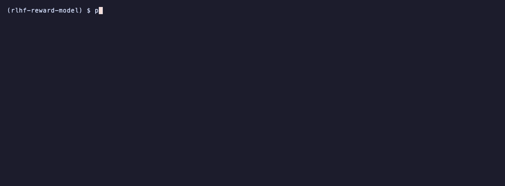
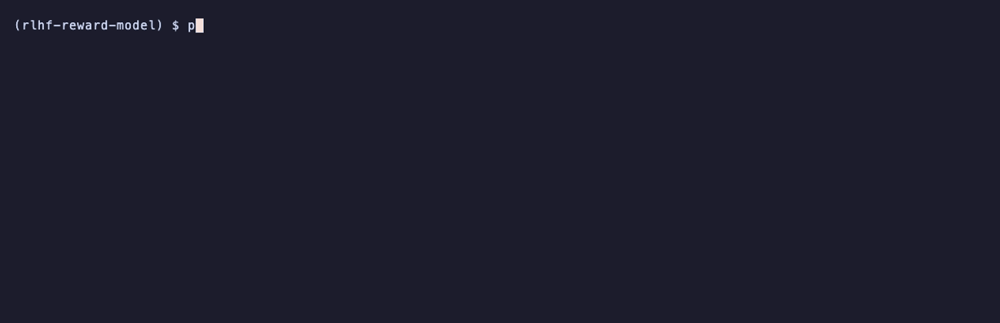

<h1 align="center">RLHF Reward Model</h1>

<p align="center">
  <em>A small, from-scratch version of classical reinforcement learning from human feedback (RLHF), the method that tunes chat models to human preferences.</em>
</p>

<p align="center">
  <a href="https://github.com/adeoluo/rlhf-reward-model/actions/workflows/ci.yml"></a>
  <a href="https://github.com/adeoluo/rlhf-reward-model/releases"></a>
  
  <a href="LICENSE"></a>
</p>

---

> **Evidence level: unit tested.** One gradient, the hand-derived gradient of the Direct Preference Optimization (DPO) loss, is checked against finite differences, a slow but simple numerical estimate. A gradient is the update direction used in training. Every experiment runs on a synthetic task in which each example is described by 12 numbers, called features, and no language model is involved. The results have not been reproduced by anyone else, and the code is not used in production.

## Highlights

Chat models are tuned with human preferences. People pick the better of two answers, and a
"reward model" learns their taste. The chat model is then trained to score well on that reward
model. This project is a small working copy of that whole loop. It also compares two training
methods and measures what happens when a reward is optimized too hard.

- **The reward model learned the hidden taste almost perfectly.** Its scores have a Pearson
  correlation of 0.998 with the hidden true reward, where 1.0 is a perfect match. So its scores
  rise and fall almost exactly with the hidden reward.
- **Training on that reward worked.** Proximal Policy Optimization (PPO), a reinforcement
  learning method, closed 96.6% of the gap between the starting model and the best possible
  behavior. DPO, a method that needs no reward model, closed 89.2%.
- **The DPO gradient is checked independently.** A test recomputes the DPO loss with NumPy, a
  Python library for numerical arrays, and estimates its gradient by finite differences. The
  hand-derived DPO gradient must agree with that estimate. The hand-derived gradients for the
  reference policy, the reward model and PPO have no such check.

**Where it falls short:** Everything runs on a made-up task in which each example is described
by 12 numbers. There is no language model in it. It shows how the method works, not how a real
chatbot would behave.

## Key terms

Plain definitions of the terms used in this README.

| Term | Meaning |
|---|---|
| Beta (`beta`) | The strength of the KL penalty. A higher beta keeps the policy closer to the reference policy, and a lower beta lets it move further. |
| Bradley-Terry model | A model of choice between two options. The chance that one response beats another depends only on the difference between their rewards. |
| DPO (Direct Preference Optimization) | A training method that fits the policy directly to preference pairs with one loss. It uses no separate reward model and no reinforcement learning. |
| Finite differences | A slow but simple way to estimate a gradient: change each weight slightly and measure how the loss changes. Here it checks only the DPO gradient. |
| Goodhart's law | The rule that a measure stops being a good measure once it becomes a target. |
| Gradient | How fast a score changes when each model weight changes, and in which direction. Training follows it to improve the score. |
| Held-out ranking accuracy | The share of preference pairs not used in training where the reward model scores the truly better response higher. From 0 to 1, higher is better. |
| KL divergence (Kullback-Leibler divergence) | A measure of how different two probability distributions are. It is 0 when they are identical and grows as they differ more. |
| KL penalty | A cost on the KL divergence between the policy and the reference policy. It keeps the policy from drifting too far from the reference. |
| Mean KL to reference | The KL divergence between the policy and the reference policy, averaged over prompts. Lower means the policy changed less. |
| Misspecified reward model | A reward model that cannot represent the true reward. In the over-optimization study it sees only 4 of the 12 features. |
| Optimal reward | The average true reward of the best response for each prompt. No policy can score higher. It is 1.144 here. |
| Pearson correlation | How closely two sets of numbers rise and fall together, from -1 to 1. Higher is better here, and 1.0 is a perfect match. |
| Policy | The model that chooses a response for each prompt. It gives each candidate response a probability. |
| PPO (Proximal Policy Optimization) | A reinforcement learning method that improves a policy against a reward in small, limited steps. |
| Preference pair | One comparison for a prompt: a chosen response and a rejected response. Here a simulated annotator produces them, with some noise. |
| Proxy reward | The score from a learned reward model, which stands in for the true reward. A high proxy reward does not guarantee a high true reward. |
| Reference policy | The starting policy, trained to copy example answers. PPO and DPO both start from it and are measured against it. |
| Reward gap closed | The policy's gain in true reward over the reference, divided by the optimal reward's gain over the reference. From 0% to 100%, higher is better. |
| Reward model | A model that learns to score responses from preference pairs. Here its score is a weighted sum of the 12 features. |
| Reward over-optimization | Optimizing a learned reward so hard that the policy exploits its errors. The proxy reward keeps rising while the true reward falls. |
| RLHF (reinforcement learning from human feedback) | Training a model by trial and reward, where the reward is learned from human comparisons between pairs of answers. |
| Sample efficiency | How much true reward a method reaches for a given number of preference pairs. A higher reward from fewer pairs is better. |
| Synthetic task | A made-up task with 6 prompts and 5 candidate responses each. Each prompt-response pair is described by 12 random numbers, called features. |
| True reward (gold reward) | The hidden scoring rule that defines which responses are truly good. The learner never sees it. Higher is better. |

## Motivation

RLHF is the classical post-training recipe behind assistants that follow instructions.
Post-training is the training a model receives after it has learned general language. The
recipe has three stages. First, supervised fine-tuning teaches the model from example answers.
Second, a **reward model** is trained on human comparisons between pairs of answers. Third, the
policy, the model that chooses answers, is optimized against that reward. This last stage uses
a clipped policy gradient. A policy gradient shifts the policy toward answers with a higher
reward, and clipping limits how far each update can move the policy. A penalty on
the Kullback-Leibler (KL) divergence holds the policy near the reference model from the first
stage. KL divergence measures how different two probability distributions are.

This project builds the whole pipeline **from scratch** on a small alignment task, a task of
making a model's choices match a hidden goal. Every quantity in it can be computed exactly. The reference is fit by **behavior cloning**, which means
training it to copy example answers. The **Bradley-Terry reward model** is fit by convex
logistic regression, a standard method with a single best solution. **PPO** then trains the
policy with a clipped surrogate objective, a training target that limits each update, and a
reward that includes the KL penalty. The project
also builds the alternative that needs no reward model, **Direct Preference Optimization
(DPO)**. It runs a **head-to-head comparison of PPO and DPO** on the same task. None of this
uses automatic differentiation, the library feature that computes gradients automatically.
Finally, the project shows the failure that makes reward modeling hard: **reward
over-optimization**. A policy pushed too hard on a learned reward starts to exploit its errors.

## Architecture

<p align="center">
  
</p>

<sub>Legend: amber = entry points and external systems, indigo = core logic, green = data and state, blue = validation and control, grey = observability and outputs.</sub>

A hidden gold reward defines the truth. It generates the demonstrations, which are example
answers, and the Bradley-Terry preference pairs. The pipeline runner first fits a reference by
behavior cloning. It then fits a reward model on the preferences. Next it optimizes a PPO policy
against the learned reward, with a KL penalty that anchors the policy to the reference. DPO fits
a policy directly to the same preferences. The learner never sees the true reward. The report,
the comparison of PPO with DPO, and the over-optimization study all measure the outcome against
the gold reward. The [ADRs](docs/adr/), or architecture decision records, explain the key
decisions.

### The pipeline

- **Supervised fine-tuning.** A reference policy is fit by behavior cloning to weakly aligned
  demonstrations, which are example answers that are only partly good. The fit uses penalized
  maximum likelihood. It makes the example answers as probable as possible, with a penalty that
  keeps the weights small.
- **Reward model.** A linear reward, a weighted sum of the 12 features, is fit by
  **Bradley-Terry** logistic regression on preference pairs. In this model, the probability that the chosen response beats the rejected
  one is the logistic function of their reward difference. The logistic function turns any
  number into a probability between 0 and 1. The objective is concave, meaning it has a single
  peak. So full-batch gradient ascent, which uses every pair at every step, reaches the
  regularized optimum. That is the best set of weights once the penalty on large weights is
  included.
- **PPO.** The policy is optimized against the learned reward with the clipped surrogate
  objective. This objective stops pushing a response's probability once it has moved too far
  from its value at the start of the iteration. The KL penalty is folded into the reward as
  `shaped = reward_model(y) - beta * (log policy_old(y) - log reference(y))`, where `beta` sets
  the strength of the penalty. Each iteration samples responses from the current policy. It
  estimates a per-prompt baseline, the average shaped reward for each prompt, and then takes
  clipped gradient steps. The policy is log-linear: each response's probability is proportional
  to the exponential of a weighted sum of its features. So the policy-gradient term is exact.
- **DPO.** Direct Preference Optimization skips the reward model. It fits the policy directly to
  the preferences with a single logistic loss on the implicit reward margin. A loss is a number
  that training makes smaller. The implicit reward
  is `beta * log(policy / reference)`. It measures how much more
  probable the policy makes a response than the reference does. For the log-linear policy the
  gradient is exact and derived by hand. So PPO and DPO share the same optimizer and differ only
  in method.

### Components

- **domain**: the alignment task, the hidden gold reward, the teacher that produces the
  demonstrations, and the Bradley-Terry annotator that produces the preferences.
- **policy**: a log-linear softmax policy with exact probabilities and gradients.
- **sft**: behavior cloning of the reference.
- **reward_model**: the Bradley-Terry reward model, with an optional misspecified variant that
  cannot represent the true reward.
- **ppo**: the clipped PPO objective with a KL-shaped reward and a per-prompt baseline.
- **evaluation**: how closely the reward model matches the gold reward, the true reward, the KL,
  and the reward-model ceiling. The ceiling is the true reward of the response that the reward
  model likes best for each prompt.
- **pipeline**: the full three-stage run from start to end.
- **dpo**: Direct Preference Optimization with an exact gradient derived by hand.
- **comparison**: the head-to-head comparison of PPO with DPO on final quality and sample
  efficiency.
- **overoptimization**: the reward over-optimization study with a misspecified reward model.

## Results

> Reproduce with `python -m rlhf_reward_model evaluate`. All metrics are computed against the
> hidden gold reward, which the learner never sees.

Each row is one measure of the default run. The first two rows rate the reward model and the
last three rate the PPO policy. Higher is better for every row except mean KL, which shows how
far the policy moved from the reference.

| Metric | Value |
|---|---:|
| **reward model true-reward correlation (Pearson)** | **0.998** |
| reward model held-out ranking accuracy | 0.984 |
| **policy reward gap closed (reference to optimal)** | **96.6%** |
| policy true reward (reference to PPO) | 0.589 to 1.125 (optimal 1.144) |
| mean KL to reference | 1.673 |

The reward model recovers the hidden reward almost exactly, with a Pearson correlation of
**0.998**. PPO, optimizing that reward, **closes 96.6 percent of the true reward gap** between
the supervised reference and the optimum. Meanwhile the KL penalty keeps the policy anchored to
the reference.

### PPO vs DPO

> Reproduce with `python -m rlhf_reward_model methods`, or with uv, the Python project manager:
> `uv run python benchmarks/compare_methods.py`. PPO and DPO get the **same** reference, the
> **same** preferences, and the **same** full-batch optimizer, so the comparison isolates the
> method.

Each row is one method. True reward and gap closed show the quality reached, and higher is
better. Mean KL to reference shows how far the policy moved, and lower means a gentler change.

| Method | true reward | gap closed (reference to optimal) | mean KL to reference |
|---|---:|---:|---:|
| **PPO** (reward model + clipped policy gradient) | **1.1247** | **96.6%** | 1.67 |
| **DPO** (direct, no reward model) | 1.0839 | 89.2% | **1.08** |

The next table shows sample efficiency: the true reward each method reaches as the number of
preference pairs grows. Each row is a number of preference pairs, each column is a method, and
a higher true reward is better.

| preference pairs | PPO | DPO |
|---:|---:|---:|
| 250 | 1.0144 | 1.0074 |
| 500 | 1.0438 | 1.0308 |
| 1,000 | 1.0862 | 1.0247 |
| 2,000 | 1.0897 | 1.0740 |
| 4,000 | **1.1247** | 1.0839 |

Reading the tables: on this synthetic task, **PPO reaches a higher true reward**. It closes
96.6% of the gap, compared with 89.2% for DPO, and it stays ahead at every data size. The reason
is its explicit reward model, which recovers the hidden reward almost exactly (Pearson
correlation **0.998**). That gives the policy a dense, well-specified target to optimize: it
scores every response, and its linear form can represent the true reward. **DPO is simpler**,
with no reward model and one loss. It reaches a comparable policy at a **lower KL to the
reference**, 1.08 compared with 1.67, which means a gentler update. The gap between the methods
is small and specific to this well-specified linear setting. The point is a measured,
like-for-like comparison of two methods built from the same parts. It is not a general claim
that one method is always better. Both betas are tuned so that neither method is at a
disadvantage.

### Reward over-optimization (Goodhart's law)

> Reproduce with `python -m rlhf_reward_model overoptimize`. The library exposes it as
> `overoptimization_study`.

A reward model is a proxy, a stand-in for the true goal. Optimizing a proxy too hard eventually
hurts the true objective. This is Goodhart's law: a measure stops being a good measure once it
becomes a target. This study uses a deliberately **misspecified** reward model, which is given
only 4 of the 12 features. As the KL penalty decreases, the proxy reward keeps rising, while the
**true reward peaks and then falls**.

Each row is one PPO run, from the strongest KL penalty (largest `beta`) at the top to the
weakest at the bottom. A higher true reward is better, while proxy reward is only the
misspecified model's own score.

| beta | proxy reward | true reward | mean KL |
|---:|---:|---:|---:|
| 0.20 | 0.238 | 0.824 | 0.92 |
| 0.10 | 0.340 | **0.938** | 1.60 |
| 0.05 | 0.414 | 0.934 | 2.60 |
| 0.02 | 0.458 | 0.859 | 3.82 |
| 0.01 | 0.458 | 0.858 | 3.83 |

These figures come from Linux on x86-64 processors, the common 64-bit design in most servers
and desktop computers. That is the platform on which continuous
integration (CI), the automated test run on GitHub, checks them. On Apple Silicon, Apple's own Mac processors, the first two
rows come out as `0.233 / 0.846 / 0.89` and `0.340 / 0.940 / 1.59`. The reason is that the
linear-algebra library rounds differently there, and sixty PPO iterations amplify the
difference. The other rows and the shape of the curve are the same. An earlier version of this
table quoted the Apple values without saying so. That is why a rerun on Linux did not match it.

This is the central cautionary result of reward modeling, reproduced from scratch. The proxy
reward rises monotonically, which means it never goes down, while the true reward turns over.
The KL budget, meaning how far the policy may move from the reference, is the control knob.

### Scale

`benchmarks/scale.py` fits the Bradley-Terry reward model on larger and larger synthetic
preference datasets, with 120 full-batch iterations each. For each dataset it reports
wall-clock time (real elapsed seconds), throughput (pairs processed per second), peak traced
memory measured with `tracemalloc` (Python's built-in
memory tracer), and held-out ranking accuracy. Peak memory grows linearly with the dataset held
in memory. Throughput per pair stays roughly flat. Accuracy saturates, meaning it stops rising,
once preferences are plentiful.

Each row is one dataset size. Lower is better for seconds and peak MiB (mebibytes of memory),
and higher is better for pairs per second (throughput) and held-out accuracy.

| preference pairs | seconds | pairs/sec | peak MiB | held-out accuracy |
|---:|---:|---:|---:|---:|
| 2,000 | 2.31 | 870 | 0.20 | 0.966 |
| 8,000 | 10.77 | 740 | 0.80 | 0.984 |
| 16,000 | 21.13 | 760 | 1.60 | 1.000 |

Caveat: the data is synthetic, and this is a from-scratch Python implementation. It is **not**
benchmarked against compiled numerical libraries. Wall-clock time and throughput were measured
on a shared development machine and will vary. Reproduce with
`uv run python benchmarks/scale.py`.

## Quickstart

```bash
git clone https://github.com/adeoluo/rlhf-reward-model.git && cd rlhf-reward-model
make setup                    # install dev tooling + pre-commit hooks
make all                      # lint + type-check + test

python -m rlhf_reward_model evaluate        # full pipeline and RLHF report
python -m rlhf_reward_model compare         # greedy choice before and after PPO
python -m rlhf_reward_model methods         # PPO vs DPO head to head
python -m rlhf_reward_model overoptimize    # the reward over-optimization curve
```

## Usage

### Demonstration

```text
$ python -m rlhf_reward_model compare
Per-prompt greedy choice (reference -> PPO policy, with the gold-best response):
  prompt 0: reference r3 -> policy r1  (gold-best r1, match)
  ...
```

### Library

```python
from rlhf_reward_model import run_pipeline, PipelineConfig, compare_ppo_dpo

result = run_pipeline(PipelineConfig(beta=0.05))
print(result.report.format())

comparison = compare_ppo_dpo()  # train PPO and DPO on the same task
print(comparison.format())
```

### Demos

These recordings come from real runs made with [vhs](https://github.com/charmbracelet/vhs), a
tool that records terminal sessions as animated images. The script for each recording, called a
tape, is in `docs/demo/`.

The first recording shows reward model accuracy, then reward over-optimization as the policy is
pushed further.

<p align="center">
  
</p>

The second recording shows, for each prompt, the greedy choice of the reference and of the PPO
policy. The greedy choice is the single most probable response. It is shown next to the
gold-best response, the response with the highest true reward.

<p align="center">
  
</p>

## Design decisions

- **A reward model and PPO, not Direct Preference Optimization.** The classical pipeline keeps
  an explicit reward that can be inspected, and it makes reward over-optimization visible.
  ([ADR-0002](docs/adr/0002-reward-model-and-ppo.md))
- **A clipped surrogate with a KL-shaped reward.** This is the standard PPO objective, with the
  KL penalty folded into the reward. It runs over a log-linear policy with an exact gradient.
  ([ADR-0003](docs/adr/0003-clipped-ppo.md))
- **Recording decisions.** Key design decisions are written down as ADRs.
  ([ADR-0001](docs/adr/0001-record-architecture-decisions.md))

## Testing

```bash
make test                     # uv run pytest
make coverage                 # pytest with an 80% coverage gate
```

The tests under `tests/` are deterministic, so they give the same result on every run, and
offline, so they need no network:

- **Core** (`test_core.py`): the reward model recovers the true reward, and a misspecified
  reward model does worse. PPO improves the policy's true reward, and the evaluation report is
  consistent. Bradley-Terry is numerically stable at extreme margins, so very large reward
  differences do not cause overflow errors.
- **DPO** (`test_dpo.py`): DPO improves the true reward, and its loss decreases with training.
  On average it widens the margin in favor of the chosen response. Its gradient is zero when
  there is no data, and its results are deterministic.
- **Gradient parity** (`test_gradient_parity.py`): an independent check of the DPO gradient
  only. It recomputes the DPO loss with NumPy and differentiates it by finite differences. It
  then asserts that the result agrees with the hand-derived DPO gradient. CI enables it
  automatically through `--group validation`. No test checks the behavior-cloning, reward-model
  or PPO gradients this way.
- **Method studies** (`test_methods.py`): PPO and DPO both improve over the reference, and the
  sample-efficiency table matches the requested sizes. The over-optimization curve turns over,
  and the study output is well formed.
- **CLI** (`test_cli.py`): the `evaluate`, `compare`, `methods`, and `overoptimize` subcommands
  of the command-line interface.

CI (`.github/workflows/ci.yml`) runs `ruff format --check`, `ruff check`, `mypy src`, and
`pytest` with an 80% coverage gate, including the NumPy finite-difference check of the DPO
gradient. Ruff is
a Python linter and formatter, mypy is a static type checker, and pytest is the test runner.
The coverage gate fails the run if the tests execute less than 80% of the source code. CI does
this on Python 3.12, 3.13, 3.14 and 3.15, then builds the package.

## Limitations

- The task is a contextual bandit with log-linear policies and a linear reward. In a contextual
  bandit, the policy sees a prompt, picks one response and receives one reward, with no sequence
  of steps. This setting was chosen so that every quantity is exact. A sequence-level policy,
  which writes an answer one token (word piece) at a time, would need per-token
  log-probabilities, the logarithm of each token's probability, and automatic differentiation.
- Preferences are simulated by a Bradley-Terry annotator. Real annotations carry different
  noise, which is often inconsistent.
- PPO here optimizes a bandit, so there is no temporal credit assignment, the task of deciding
  which earlier step earned a later reward. The value baseline is a per-prompt mean, not a
  learned critic, which would be a separate model that predicts the expected reward.

## Roadmap

These items are planned and not implemented.

- [ ] A learned value critic and generalized advantage estimation, a standard way to estimate
  how much better an action was than expected in multi-step tasks
- [ ] A token-level policy with teacher-forced log-probabilities, which score a known answer one
  token at a time while the model is given the true earlier tokens
- [ ] Reward-model ensembles, several reward models trained together, and
  uncertainty-penalized optimization, which lowers the reward where those models disagree

## License

Released under the [MIT License](LICENSE), a permissive open-source license.
